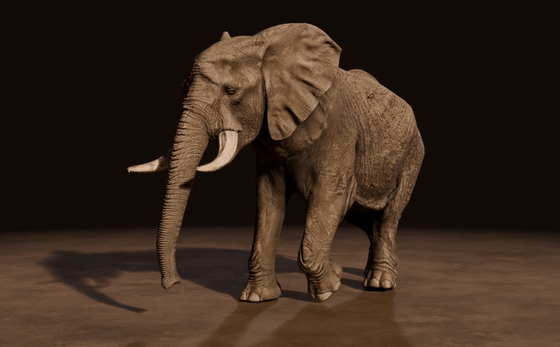
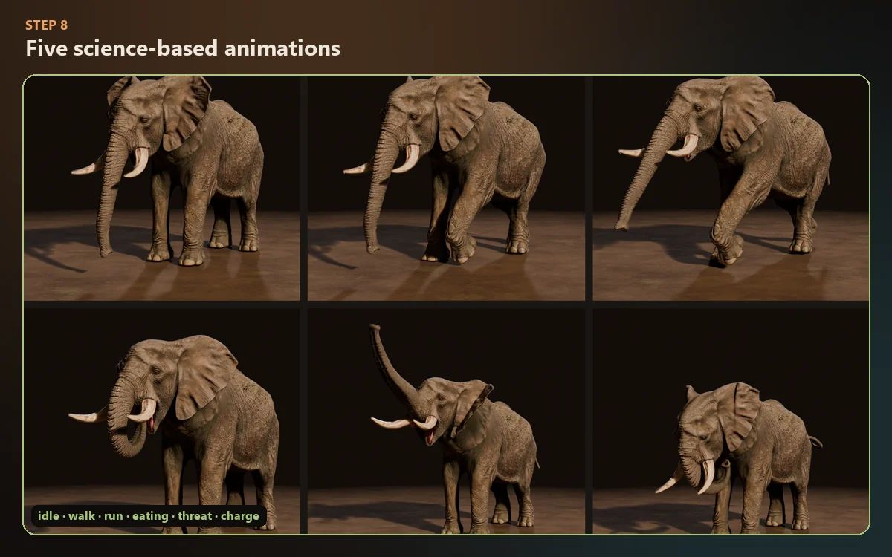
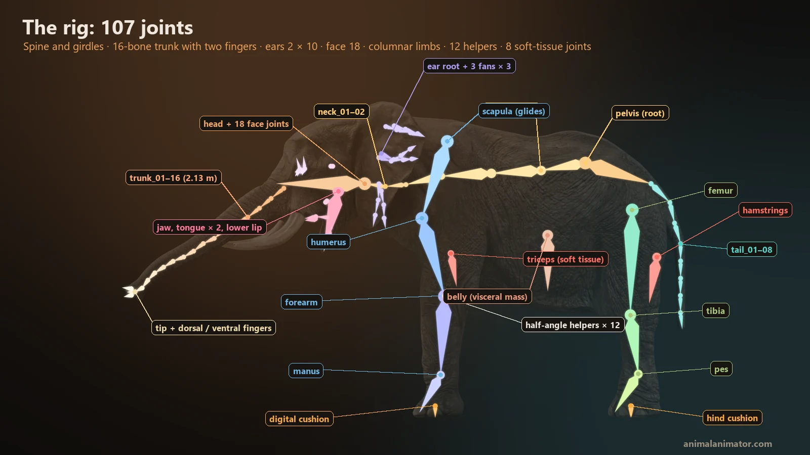
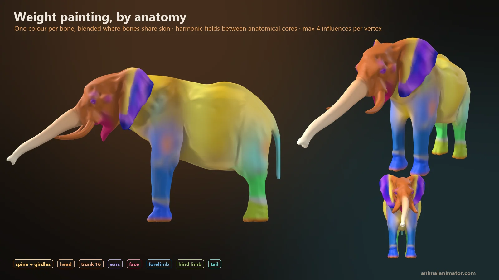
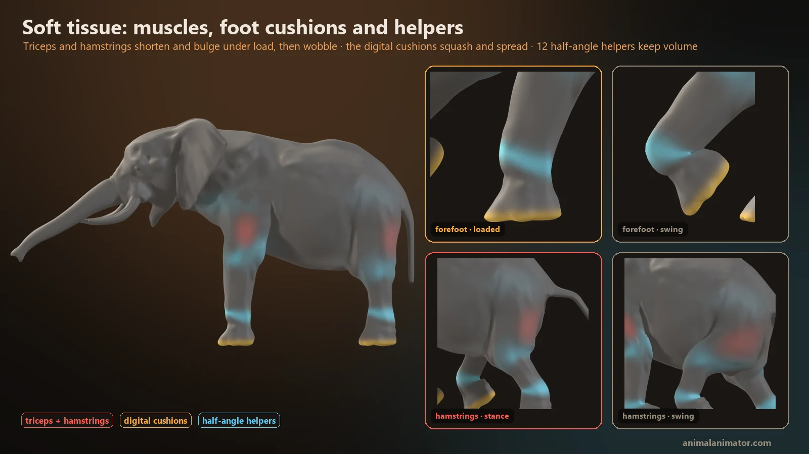
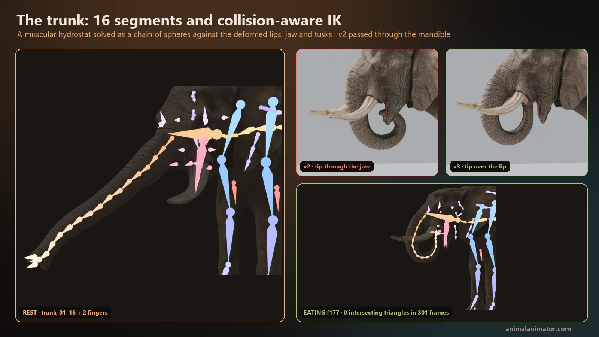
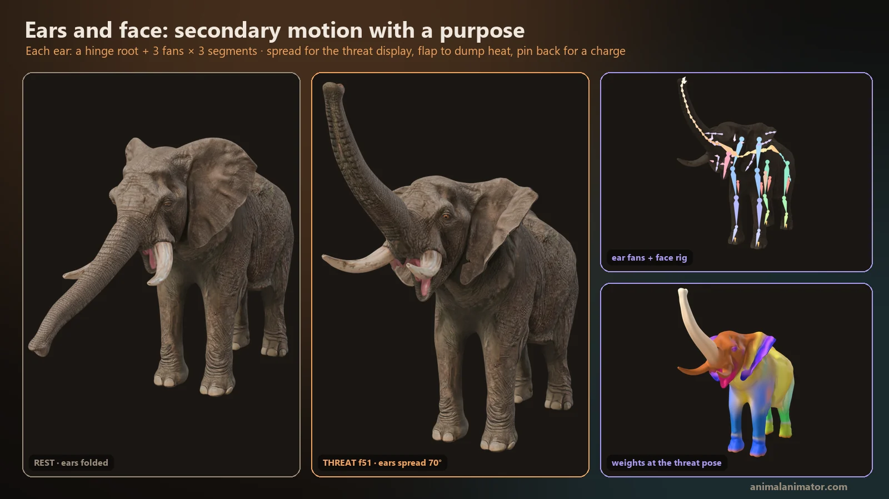

# Rigged African Elephant Bull for Blender (free, CC BY 4.0)

**A free, anatomically rigged 3D African bush elephant bull (*Loxodonta africana*) for Blender, with a 107-joint skeleton and 5 science-based animations: idle, walk, run, eating and threat & charge.**

Made by **[AnimalAnimator.com](https://animalanimator.com/)** for animators, riggers, game developers, students and teachers.

[](https://www.blender.org/)
[](LICENSE)
[](#the-rig-107-anatomical-joints)
[](#5-science-based-animations)

### [⬇️ Download the Blender file](../../releases/latest) · [🌍 Project page and 3D preview](https://animalanimator.github.io/african-elephant-rig-blender/) · [📖 Full elephant guide for animators](https://animalanimator.com/the-ultimate-african-elephant-for-animal-animators/) · [🧊 View in 3D on Sketchfab](https://sketchfab.com/3d-models/african-elephant-bull-rigged-animated-436483857ce84c77bd0f6c76fb3d4d2d)

<p align="center">
  
</p>

---

## What you get

| | |
|---|---|
| **Blender file** (`.blend`) | The complete scene: mesh, 107-joint rig, skin weights, PBR materials and all 5 animations |
| **glTF binary** (`.glb`) | A game-ready export for Unity, Unreal, Godot, three.js and web viewers |
| **Animations** | `01_Idle`, `02_Walk`, `03_Run`, `04_Eating`, `05_Attack`, at 30 fps, in place, as seamless loops |
| **Mesh** | About 85.7k triangles (body 77.8k, eyes 2 × 4.0k), quad retopology |
| **Textures** | PBR metal/rough: 8K base colour, 4K normal and 4K roughness on the body; 2K eyes |
| **Scale** | Real-world size: 3.2 m at the shoulder, about 6 m from trunk tip to tail |
| **Skin weights** | Harmonic, anatomy-driven weights, at most 4 bones per vertex |

Both files are attached to the **[latest release](../../releases/latest)**. They are not stored in the repository itself.

## 5 science-based animations

Every clip was built from published studies of how real elephants move and behave, then checked frame by frame on the skinned mesh.

| Clip | Length | What it shows |
|---|---|---|
| **01 Idle**: standing rest | 10 s | Slow weight shifts, a resting hind foot, two cooling ear flaps, a sniffing trunk tip, tail swishes, blinks and a slow breath |
| **02 Walk** | 3.6 s, 2 strides | Lateral-sequence walk at about 1.25 m/s. Compliant legs, gliding shoulder blades, wrist flexion of about 75° in swing and foot pads that squash on contact |
| **03 Run**: "grounded running" | 1.7 s, 2 strides | Elephants never leave the ground. Four evenly spaced footfalls at about 4 m/s, springy legs and a centre of mass that moves only about 1 cm |
| **04 Eating**: grazing | 10 s | The trunk wraps a grass tuft, the forefoot kicks it loose, and the trunk curls the food into the mouth between the tusks, followed by fore-and-aft chewing |
| **05 Attack**: threat display and charge | 6 s | Ears spread, head shake and raised trunk, then a serious charge with ears pinned, trunk tucked and tusks forward |

<p align="center">
  
</p>

## The rig: 107 anatomical joints

<p align="center">
  
</p>

- **Spine:** pelvis root, 4 thoracolumbar and 2 cervical segments, skull, and a visceral-mass bone for breathing and belly sway
- **Trunk:** 16 segments that shorten toward the tip, plus the two "fingers" of the African trunk tip
- **Ears:** a hinge root plus 3 fans of 3 segments on each side (20 joints) for flapping, spreading and folding
- **Face:** 18 joints, including the jaw, a 2-segment tongue, a pointed lower lip, mouth corners, cheeks, eyes, lids, brows and temporal (musth) glands
- **Limbs:** columnar legs with scapula, humerus, forearm and manus at the front, and femur, tibia and pes at the back
- **12 corrective joints:** shoulder, elbow, carpus, hip, knee and tarsus. Each one is driven at half the angle of its joint, so the legs keep their volume
- **8 soft-tissue joints:** triceps and hamstrings that bulge under load, and four foot cushions that squash and spread on every step
- **Tail:** 8 caudal segments

| | |
|---|---|
|  |  |
| **Weight painting by anatomy.** Each colour is one bone; harmonic fields blend the ears, trunk, face and legs. | **Soft tissue.** Muscles bulge and wobble, the foot cushions squash, and 12 helpers keep joint volume. |
|  |  |
| **The trunk.** 16 segments, solved so the tip slides into the mouth without passing through the jaw. | **Ears and face.** Spread for the threat, flapped to cool, pinned back for the charge. |

## How to use it in Blender

1. Download the `.blend` file from the **[latest release](../../releases/latest)**.
2. Open it in **Blender 5.1 or newer**. It was made in Blender 5.1; older versions may not open it correctly.
3. Press **Space** in the viewport to play the current animation.
4. To switch clips, open the **Dope Sheet → Action Editor** and choose `01_Idle`, `02_Walk`, `03_Run`, `04_Eating` or `05_Attack`.
5. To bring the elephant into your own scene, use **File → Append**, open the `.blend`, and append its collection or objects.

**Game engines:** import the `.glb` file. The five clips come in as named animations, and the corrective and soft-tissue joints are baked in, so the legs keep their shape in any glTF viewer or engine.

## License and how to credit

This model is released under **[Creative Commons Attribution 4.0 (CC BY 4.0)](LICENSE)**. You can use it in personal, educational and commercial projects, and you can change it, as long as you give credit.

Please credit it like this, with the link, in your video description, project page, game credits or portfolio:

```
African Elephant Bull 3D model by AnimalAnimator.com (https://animalanimator.com), licensed under CC BY 4.0
```

## The science behind the animations

- Hutchinson et al. (2003). *Are fast-moving elephants really running?* Nature 422: 493–494.
- Hutchinson et al. (2006). *The locomotor kinematics of Asian and African elephants: changes with speed and size.* J Exp Biol 209: 3812–3827.
- Ren & Hutchinson (2008). *The three-dimensional locomotor dynamics of African and Asian elephants.* J R Soc Interface 5: 195–211.
- Ren et al. (2008). *The movements of limb segments and joints during locomotion in African and Asian elephants.* J Exp Biol 211: 2735–2751.
- Genin et al. (2010). *Biomechanics of locomotion in Asian elephants.* J Exp Biol 213: 694–706.
- Ren et al. (2010). *Integration of biomechanical compliance, leverage, and power in elephant limbs.* PNAS 107: 7078–7082.
- Weissengruber et al. (2006). *The structure of the cushions in the feet of African elephants.* J Anat 209: 781–792.
- Buss & Estes (1971). *The functional significance of movements and positions of the pinnae of the African elephant.* J Mammalogy 52: 21–27.
- Poole & Granli (2011). *Signals, gestures and behavior of African elephants.* In *The Amboseli Elephants*; ElephantVoices *Elephant Ethogram*.
- Larramendi (2016). *Shoulder height, body mass and shape of proboscideans.* Acta Palaeontologica Polonica 61: 537–574.

The full story (elephant anatomy, foot and trunk science, gait data and how the rig was built) is in **[The Ultimate African Elephant for Animal Animators](https://animalanimator.com/the-ultimate-african-elephant-for-animal-animators/)**.

## More from AnimalAnimator.com

- [Blender Rigify for rigging animals and making epic animations](https://animalanimator.com/blender-rigify-for-rigging-animals-and-making-epic-animations/)
- [Animal locomotion: idle, walk, run and jump animator controller in Unity](https://animalanimator.com/animal-locomotion-idle-walk-run-jump-animator-controller-unity/)
- [The Animator's Menagerie: top 10 land animals for mastering creature animation](https://animalanimator.com/the-animators-menagerie-top-10-land-animals-for-mastering-creature-animation/)
- [The Ultimate Sphinx Cat Reference for Animal Animators](https://animalanimator.com/the-ultimate-sphinx-cat-reference-for-animal-animators/)
- [The Ultimate White Shark Anatomy for Animal Animators](https://animalanimator.com/the-ultimate-white-shark-anatomy-for-animal-animators/)
- [The Ultimate Hummingbird Reference for Animal Animators](https://animalanimator.com/the-ultimate-hummingbird-reference-for-animal-animators/)

---

⭐ If this elephant helps your project, star the repository and tell us what you made with it at **[animalanimator.com](https://animalanimator.com/)**.
